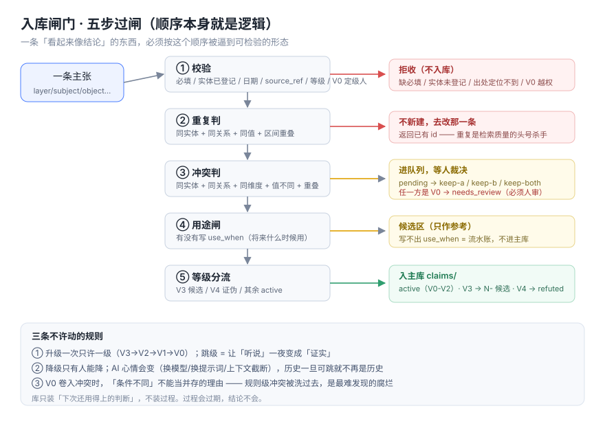

# 我们为什么要给 AI 的记忆装一个"门"

> 一个 AI 记忆库最贵的错误，不是记错，而是**记得很自信，却查不到凭什么**。
> 开源地址：https://github.com/XY-livo/memory-ingest-gate

---

## 一、先讲三个真实场景

**场景一：同一个人，三种写法。**

库里同时有「张工」「张老师」「老张」，三条记录各说各的。你问"张工偏好什么"，检索只命中三分之一。
不是检索不行，是**进来的时候没人拦**。

**场景二：结论在，出处没了。**

一条"客户不接受账期"，三个月后谁说的、哪天说的、原话是什么，全查不到。
这条记录从此只有两种命运：被当真理用，或者被当垃圾删。**都错。**

**场景三：重复被当成冲突。**

同一件事写了两遍，系统一比对"值不同"——其实只是措辞不同——于是进了待裁决队列。
人一开始还认真看，看到第十条就开始乱点。**队列一乱，整套机制就废了。**

这三个场景，都不是"模型不够聪明"，是**门没装**。

---

## 二、门装在哪：五步，顺序不能换

我们把写入闸做成五步，顺序本身就是逻辑：

```
① 校验 → ② 重复 → ③ 冲突 → ④ 用途 → ⑤ 等级分流
```



**为什么重复必须在冲突之前？**
同一件事写成两条，本质是重复；先判冲突，就会把它塞进"待裁决"，让人的注意力消耗在自己跟自己的分歧上。

**为什么用途要单独一步？**
"这条以后什么时候会用到"——写不出来的，说明它只是流水账。流水账进候选区，不进主库。
一条规矩：**库只装下次还用得上的判断，不装过程。**

**为什么等级最后分流？**
先定等级再判冲突，会出现"未证实的东西因为等级低，就被当成不重要"——而它可能是最重要的线索，只是还没验证。

---

## 三、五档证据等级，四条硬规则

| 级 | 含义 | 谁能定 |
|---|---|---|
| V0 | 本人定的规则 | **只有本人** |
| V1 | 已证实（本机可复现） | 可以给，但必须写清"怎么跑、输出是什么" |
| V2 | 侧面证实（文档/网页/转述） | AI 最高到这里 |
| V3 | 未证实 | 只进候选区 |
| V4 | 已证伪 | 排除 |

四条硬规则里，有两条当时被质疑过，现在我认为是整套东西的骨头：

**第一，升级一次只能升一级。**
允许跳级，就等于允许"听说"一夜之间变成"证实"。历史一旦可以跳，它就不再是历史。

**第二，降级只有人能降。**
AI 的"心情"会变——换模型、换提示词、上下文截断。如果 AI 能降级，昨天 V1 的结论今天可能悄悄变成 V3；**不是因为它错了，是因为没有人在看。**
降级是权力，不是操作。

---

## 四、冲突：不许静默覆盖

规则很朴素：同一实体、同一关系、同一维度、值不同、时间重叠 → 进队列，等人裁决。

三个选项：留旧的、留新的、两个都留。

有一条例外值得单说：**如果冲突里有一方是 V0（本人定的规则），"条件不同"不能成为并存的理由，必须人审。**
因为规则级的冲突被"条件不同"洗过去，是最难发现的一种腐烂——表面上两条都还在，实际上系统已经偷偷换了一套标准。

---

## 五、这套东西不做什么

它不做向量检索，不做 RAG，不接任何模型。

**它只管进门那一步。**

因为它不负责判断内容对不对——它负责保证：每一条都能被检验、被回溯、被推翻。
剩下的检索、召回、摘要，用什么方式都行。**门装好了，屋里放什么才谈得上。**

---

## 六、落地成本

一个目录 + 一个零依赖的 Python 3 脚本：

```bash
python3 src/gate.py init --vault vault
python3 src/gate.py entity add E01 "张工"
python3 src/gate.py --vault vault add --json claim.json
```

重复提交会被拒，并告诉你"已经有这条，去改它"：

```json
{"ok": false, "status": "duplicate", "existing": "C-20261106-001"}
```

跑一遍自测就知道这套规则长什么样（不会碰你的库）：

```bash
python3 src/gate.py selftest
```

---

## 七、一句话收尾

**AI 的记忆不缺容量，缺的是门槛。**

我们花了很久才接受一件事：让 AI 记得更多，不如让它记得的每一条都**站得住**。
站得住的标准只有三条——能复现、能回溯、能推翻。

缺一条，它就只是"看起来很懂的胡说"。

---

*仓库：https://github.com/XY-livo/memory-ingest-gate （MIT）*
